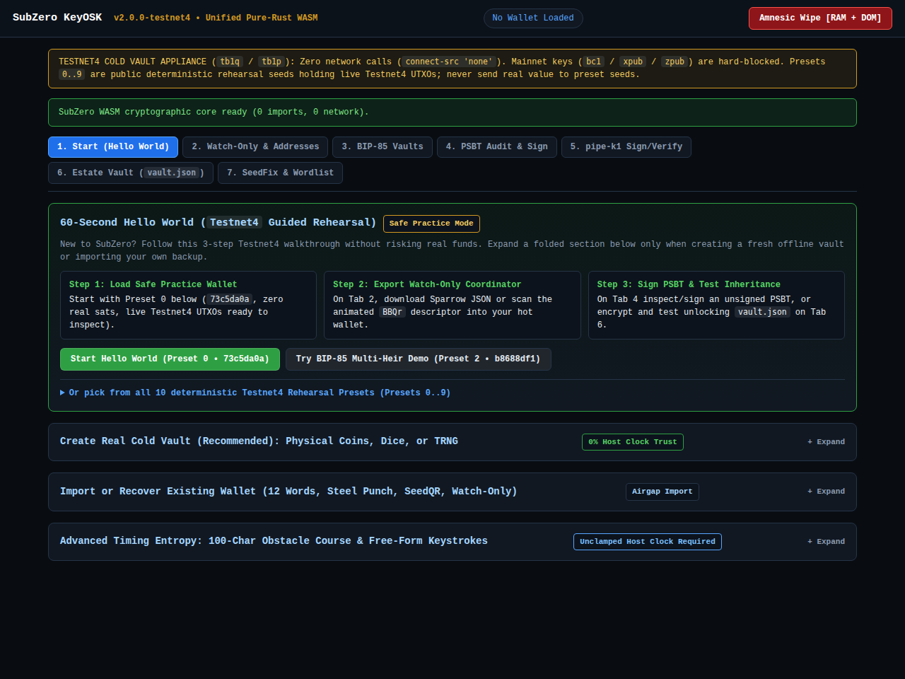
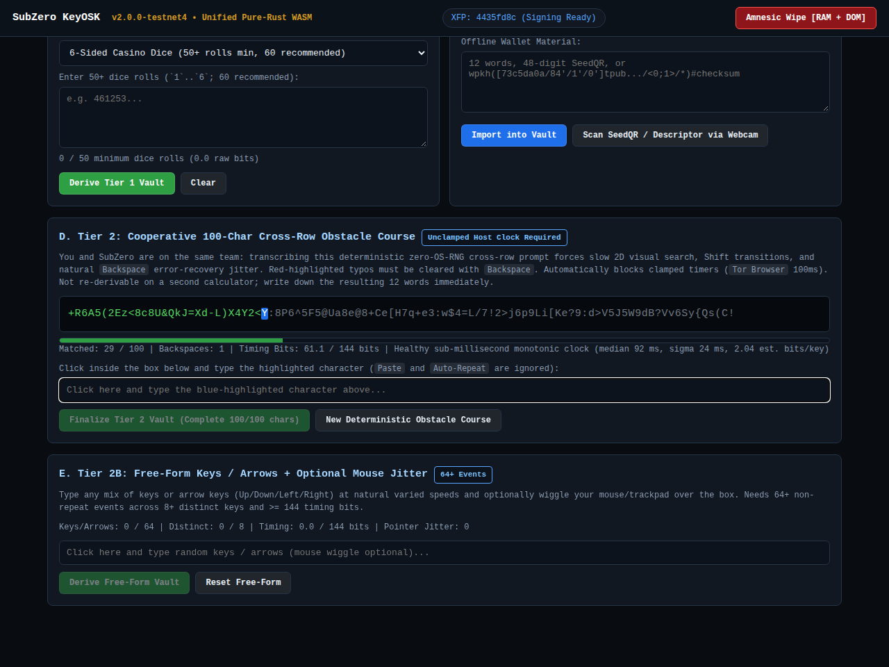
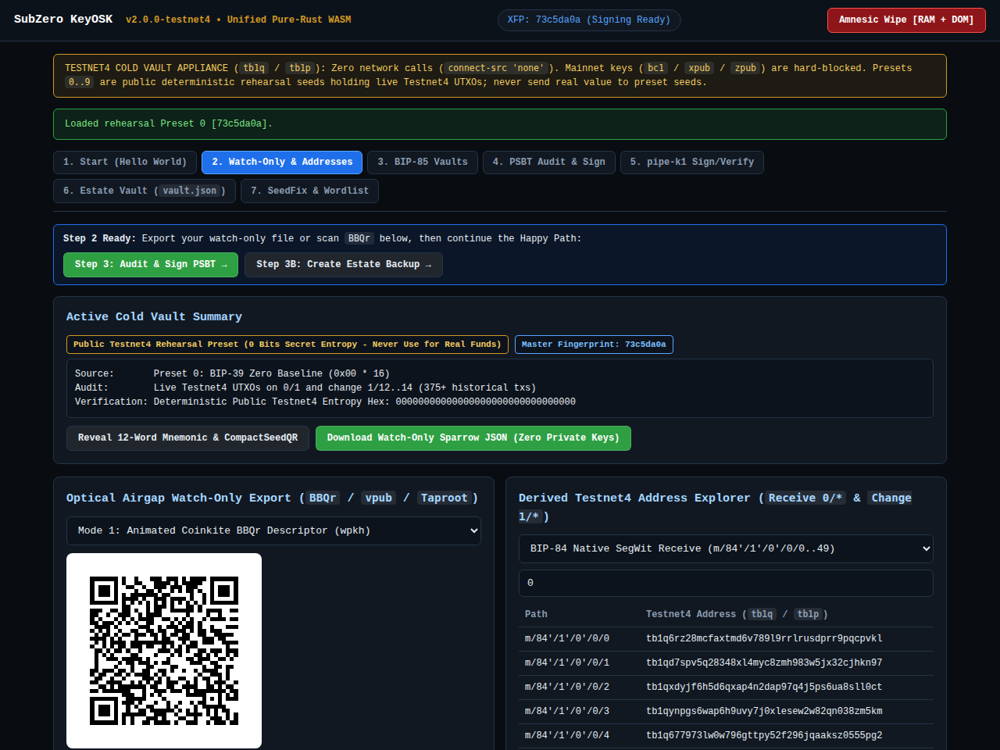
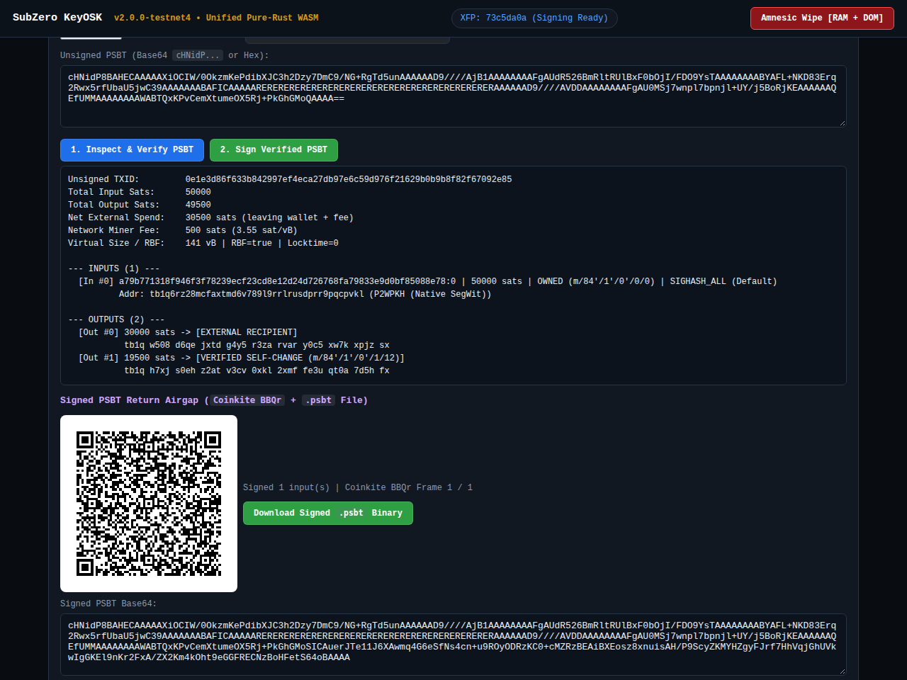

# SubZero Keyosk v2.0 (`Bitcoin Testnet4`)

**SubZero Keyosk** is an airgapped, zero-OS-RNG Bitcoin Testnet4 (`BIP-94`) cold vault, PSBT airgap signer, `BIP-85` child-vault manager, and `pipe-k1` release-signing tool.

In v2.0, **all execution targets** compile from one pure-Rust cryptographic core (`crates/subzero-core`) with zero OS-RNG calls in key generation, PSBT signing, vault encryption, `--self-test`, headless CLI commands, or the standalone WebAssembly bundle:

1. **Bare-Metal Linux Cold Vault & Headless CLI (`dist/subzero-x86_64-musl`)**: Static `musl` binary combining a headless stdin/fd UNIX CLI (`derive`, `inspect-psbt`, `sign-psbt`, `vault-seal`, `vault-unseal`, `seedfix`, `descriptor-checksum`, `0` `getrandom` calls) with an interactive `ratatui` TTY1 console (`mlockall`, `v4l2-ctl` + pure-Rust `rqrr` camera scan, atomic `SUBZERO_EST` storage, and post-exit `memtester-static` + `init_on_free=1` RAM scrub). Interactive TUI mode uses Rust std `HashMap` seeding only for UI layout state, never for cryptographic keys.
2. **Standalone Single-File HTML Kiosk (`dist/subzero-keyosk.html` & `dist/decrypt.html`)**: Self-contained offline `file://` HTML files embedding `subzero-core` compiled to zero-import WebAssembly (`wasm32-unknown-unknown`), isolating active mnemonics inside WASM linear memory, and locking the DOM with hash-pinned Content Security Policy (`CSP`) headers.

## Reader Orientation Map

* **[README.md](README.md)** (this file): Quickstart, Cooperative Two-Tier Entropy guide, funded Testnet4 rehearsal presets, bit-for-bit reproducible builds, and signature verification.
* **[docs/ARCHITECTURE.md](docs/ARCHITECTURE.md)**: Crate layout (`subzero-core`, `subzero-tui`, `subzero-wasm`), WASM secret isolation and memory scrubbing ABI, `subzero-vault-v2` SIV format, and two-partition UEFI USB appliance layout.
* **[SECURITY.md](SECURITY.md)**: Threat model, trust boundaries, scope limits, v2.0 security audit fixes, verification provenance, and disclosure contact.

---

## Quickstart

### Option A: Offline Single-File Browser Kiosk (`0` Installation)

1. Download `subzero-keyosk.html`, `decrypt.html`, `SHA256SUMS`, `SHA256SUMS.asc`, and `SHA256SUMS.pk1` from the latest GitHub Release (or build them locally from source with `./scripts/build_reproducible.sh`).
2. Verify `SHA256SUMS` and its detached signatures (see [Reproducible Builds and Release Verification](#reproducible-builds-and-release-verification) below).
3. Disconnect Wi-Fi, Ethernet, and Bluetooth, then open `subzero-keyosk.html` directly from disk (`file:///.../subzero-keyosk.html`) in a standard unclamped desktop browser (Chromium or standard Firefox).

### Option B: Static Linux Console Binary (`x86_64-unknown-linux-musl`)

```bash
# Build dist/ artifacts bit-for-bit deterministically inside Docker (or download from GitHub Releases):
./scripts/build_reproducible.sh

# Run deterministic Known-Answer Self-Tests (Presets 0..9, BIP-380, P2WPKH/P2TR PSBT, pipe-k1, SIV Vault):
./dist/subzero-x86_64-musl --self-test

# Launch the interactive 7-tab terminal cold vault:
./dist/subzero-x86_64-musl

# Or run headless CLI subcommands (secrets passed via stdin or --*-fd >= 3):
./dist/subzero-x86_64-musl derive --preset 0 --public-only
./dist/subzero-x86_64-musl inspect-psbt --preset 0 --strict < tx.psbt
./dist/subzero-x86_64-musl sign-psbt --preset 0 < tx.psbt > signed.psbt
```

To build a bootable, network-stripped two-partition UEFI `x86_64` USB/SD image (`SUBZERO_ESP` + `SUBZERO_EST` booting into RAM-resident `initramfs` without `--privileged` containers):

```bash
./scripts/deploy_appliance.sh
```

---

## Cooperative Two-Tier Entropy Architecture

A cold vault and its human operator are on the same team. SubZero never queries OS randomness (`getrandom`, `/dev/urandom`, or `crypto.getRandomValues()`) for key derivation, PSBT nonces, or encryption. Instead, it separates human-supplied entropy into **two explicit trust tiers** so you always know whether your seed depends on the host CPU clock:

| Tier | Input Modes | Built-In Guardrails for Cooperative Operators | Trust Boundary Badge |
| :--- | :--- | :--- | :--- |
| **Tier 1: Physical Discrete Entropy** | **128+ Coins** (`1/0` or `H/T`), **50+ Casino Dice** (`60` recommended, `1..6`), or **32-Char Hardware TRNG Hex** | Coins and dice run pre-hash Markov transition, Pearson Chi-squared (`p = 0.001`), periodic pattern, and public-preset blocklist checks; TRNG hex checks 32-hex format, non-constant bytes, and preset collisions. | **2nd-Device Verifiable (`0%` Host Clock Trust)**: Identical 12-word mnemonic can be verified independently on a separate offline calculator. |
| **Tier 2: Cooperative Keystroke Timing** | **100-Char Cross-Row Obstacle Course** (`TUI + HTML`), or **Free-Form Keys/Arrows + Pointer Jitter** (`Tier 2B`, `64+` events over `8+` distinct keys in `HTML`) | Generates a deterministic zero-OS-RNG 100-character string jumping across shifted symbols, digits, uppercase, and lowercase rows without lookalike glyphs (`0/O`, `1/l/I`). Red typos lock advance until `Backspace` fixes them; replays the full transcript, rejects OS key-repeat, **auto-blocks clamped clocks** (`Tor Browser` `100ms` / `resistFingerprinting` `16.67ms` / `2ms`..`10ms` coarse timers) and metronomic cadence (`> 72%` octave transitions), and requires `>= 144` conservative `2ms`-binned MCV timing bits in both Tier 2A and Tier 2B. | **Host-Timed (`Unclamped Clock Required`)**: Strong against external brute-force, but relies on an honest monotonic host clock (not re-derivable on a 2nd calculator from the prompt text alone). |

---

## Unified `Preset 0..9` Funded Testnet4 Rehearsal Seeds

Both the Bare-Metal TUI and the Single-File HTML Kiosk ship with the exact same **10 deterministic public Testnet4 rehearsal presets** (`0` bits of secret entropy, strictly badged for rehearsal only, and blocked from accidental re-derivation in live Tier 1/2 modes). These presets hold live Testnet4 UTXOs across `m/84'/1'/0'` receive (`0/*`), internal change (`1/*`), and `BIP-85` child vaults so you can practice watch-only Sparrow/Electrum imports and airgap PSBT signing immediately:

| Slot | Master XFP | Deterministic Formula | Mnemonic (`Word 1 .. Word 12`) | Known Funded Testnet4 Paths |
| :--- | :--- | :--- | :--- | :--- |
| **`Preset 0`** | `73c5da0a` | `0x00 * 16` (`BIP-39` Zero Baseline) | `abandon abandon ... about` | `0/1` and change `1/12..14` |
| **`Preset 1`** | `3ce38a29` | `0x55 * 16` (Alternating `01010101`) | `fetch primary ... problem` | Change `1/1` |
| **`Preset 2`** | `b8688df1` | `0x7F * 16` + Funded `BIP-85 [1..4]` | `legal winner ... yellow` | `0/1..4`, `0/6..8` + `BIP-85` children `1..4` |
| **`Preset 3`** | `3f635a63` | `0xFF * 16` (All-Ones Max Vector) | `zoo zoo ... wrong` | `0/0`, `0/8..9`, `1/0`, `1/2` |
| **`Preset 4`** | `5b0417d1` | `0x0123456789abcdef * 2` | `abuse boss ... tattoo` | `0/1` |
| **`Preset 5`** | `05d027a5` | `0x000102...0e0f` (Sequential Bytes) | `abandon amount ... buyer` | `0/0` |
| **`Preset 6`** | `bc2b7c36` | `0xf30f8c1da665478f49b001d94c5fc452` | `vessel ladder ... picture` | `0/0` |
| **`Preset 7`** | `4bd30500` | `SHA256("correct horse battery staple")[..16]` | `seven tattoo ... shell` | `0/0..1` |
| **`Preset 8`** | `a9148b7e` | `SHA256("The Times 03/Jan/2009...")[..16]` | `plug rich ... car` | `0/0..1` |
| **`Preset 9`** | `1efb5645` | `SHA256("Running bitcoin - Hal Finney...")[..16]` | `fuel zone ... board` | Change `1/1` |

---

## Core Capabilities (Shared 1:1 Across TUI and HTML Kiosk)

* **Watch-Only Descriptors & Address Discovery**: Canonical Bitcoin Core `BIP-380` 8-character polymod checksums on both `BIP-84` Native SegWit (`wpkh([xfp/84'/1'/0']tpub.../<0;1>/*)#checksum`, `tb1q...`) and `BIP-86` Taproot (`tr([xfp/86'/1'/0']tpub.../<0;1>/*)#checksum`, `tb1p...`), `SLIP-0132` `vpub` export, Sparrow JSON export (verified zero private keys), and `CompactSeedQR` / 4-letter metal punch prefix support.
* **Verified Airgap PSBT Inspector & `BBQr` Signer**: Parses binary, Base64, Hex, or multi-frame Coinkite `BBQr` PSBTs (with frame deduplication and mid-stream splice detection). Independently re-derives every claimed self-change output (`m/84'/1'/0'/<0|1>/<idx<1000>`, plus metadata-free lookup across `0..99`) from your own `master_xprv` before marking it as change, requires verified `non_witness_utxo` full previous transactions on `SegWit v0` (`P2WPKH`) inputs (`CVE-2020-14199` defense), rejects missing input amounts or mainnet derivation paths (`m/*/0'/*`), signs `P2WPKH` (`ECDSA`) and `P2TR` (`BIP-340` Schnorr), and displays animated `BBQr` frames for optical airgap broadcast.
* **`BIP-85` Deterministic Child Vaults**: Derives `Index 0` (`Decoupled Estate Encryption Passphrase`, explicitly guarded against on-chain funding) and `Index 1..4` (`Independent Heir / Operational Sub-Wallets`, with direct in-WASM / in-TUI child pivoting).
* **Native `pipe-k1` (`m/83696968'/128002'`) Operational Identity & Release Signer**: Byte-exact wire compatibility with [`bootlace-dev/pipe-k1`](https://github.com/bootlace-dev/pipe-k1) (`105`-byte `PKSG\x01` + `BIP-340` Schnorr detached signatures and `-----BEGIN PIPE-K1 SIGNATURE-----` ASCII armor) with explicit pinned vs unpinned pubkey verification status.
* **SIV-Committed `subzero-vault-v2` Estate Storage & `decrypt.html`**: Encrypts `vault.json` recovery bundles with `600,000` `PBKDF2-HMAC-SHA256` rounds (`64`-byte OKM split into independent `AES-256-GCM` and `HMAC-SHA256` SIV keys, deterministic `XFP`-bound salt, and minimum 6-word passphrase check) so updating a vault never reuses a `(Key, Nonce)` pair. Heirs load `vault.json` offline in `subzero-tui` or standalone `decrypt.html` (`file://`).
* **`SeedFix` `<50us` Checksum Solver**: Computes all `128` valid 12th `BIP-39` checksum words directly via single-block `SHA-256` and ranks candidates by Levenshtein distance against damaged backup hints.

---

## Visual Walkthrough (`Single-File HTML Kiosk`)









---

## Reproducible Builds and Release Verification

Every release artifact (`dist/subzero-x86_64-musl`, `dist/subzero-keyosk.html`, and `dist/decrypt.html`) builds bit-for-bit deterministically inside the digest-pinned `Dockerfile.reproducible` container (`SOURCE_DATE_EPOCH=1700000000`, path-remapped Rust/C flags, `-Wl,--build-id=none`, and hash-pinned CSP headers):

```bash
# Build from source inside Docker and verify bit-for-bit match against committed SHA256SUMS:
./scripts/build_reproducible.sh --verify
```

### Dual Cryptographic Release Verification (`PGP` + `pipe-k1`)

Root public keys committed in this repository:
* **PGP Release Key** (`bootlace-dev-pgp.asc`, mirrored at `bootlace-dev-release.asc`): `F181 73E5 5464 4BB5 9018  AE50 F6E9 6FAD CA2E 8E0F` (`bootlace-dev <bootlace-dev@users.noreply.github.com>`)
* **`pipe-k1` Operational Key** (`bootlace-dev-pipek1.pub`, cross-attested in `bootlace-dev/pipe-k1`): `npub1mvlht4wj3lvfmw96qxakaln862r27nn7z84ak089zjuvavkppeeq79a4j7` (`db3f75d5d28fd89db8ba01bb6efe67d286af4e7e11ebdb3ce514b8ceb2c10e72`)

```bash
# 1. Verify OpenPGP detached signature:
gpg --import bootlace-dev-pgp.asc
gpg --verify SHA256SUMS.asc SHA256SUMS

# 2. Verify pipe-k1 BIP-340 Schnorr detached signature:
pipe-k1 verify --sig SHA256SUMS.pk1 --pub npub1mvlht4wj3lvfmw96qxakaln862r27nn7z84ak089zjuvavkppeeq79a4j7 < SHA256SUMS

# 3. Verify artifact SHA-256 digests:
#    - From a cloned git repository:
(cd dist && sha256sum -c ../SHA256SUMS)
#    - Or in a flat directory where GitHub Release assets were downloaded:
sha256sum -c SHA256SUMS
```

---

## Why COTS Hardware & Physical Entropy (`vs. Specialized Signers`)

Specialized airgapped signers (`SeedSigner`, `Krux`, `Coldcard`, `Jade`) are excellent tools. SubZero complements them by optimizing for a different threat model:

* **Supply-Chain Censorship Resistance (`Zero Flagged Hardware`)**: Ordering dedicated Bitcoin signers creates customs, courier, and home-address trails. SubZero turns *any* spare off-the-shelf `x86_64` laptop (`amnesic UEFI RAM-only boot`) or offline desktop browser (`file://`) into a cold vault with zero persistence across reboot (`Esc x2` / `Ctrl+W` wipes userland memory and runs `memtester-static` before poweroff).
* **Zero Vendor or OS RNG Reliance**: Instead of trusting OS randomness (`getrandom` / `/dev/urandom`) or opaque hardware PRNGs alone, physical coin (`128+`) and dice (`50+`) ceremonies derive deterministic seeds verifiable bit-for-bit on a second calculator.
* **Unopinionated Wallet Ingestion & Heir Simplicity**: Exports standard `BIP-84`/`BIP-86` `#checksum` descriptors, `SLIP-0132` `vpub`, Sparrow watch-only JSON, `CompactSeedQR`, 4-letter steel punch prefixes, and animated `BBQr` PSBTs compatible with Sparrow, Bitcoin Core, Electrum, and Liana. Encrypted `vault.json` recovery kits unlock cleanly in standalone `decrypt.html` (`file://`), while `Preset 0..9` funded Testnet4 wallets let new users practice real signing without risking mainnet sats.
* **Machine-Readable Auditability**: Workspace architecture, invariants, and build steps are indexed in [`llms.txt`](llms.txt) alongside bit-for-bit reproducible Docker builds (`SHA256SUMS`, `SHA256SUMS.asc`, `SHA256SUMS.pk1`).

## Roadmap (`v2.1 -> v3.0`)

* **Months 1-2 (`Audit Readiness, 12/24-Word Import & TUI Automation`)**: Add `cargo-fuzz` targets (`PSBT`, `BBQr`, `rqrr`, `subzero-vault-v2`), expand `ratatui TestBackend` console layout checks (`<= 118` cols) and TUI signing tests, add `12/24`-word BIP-39 backup import for legacy hardware-wallet estate recovery, and complete `Tier 2B` parity in `subzero-tui`.
* **Months 3-4 (`Multi-Vendor Multisig Cosigner & Usability Reviews`)**: Implement `P2WSH` and `P2TR` Miniscript multisig registration and full multi-cosigner change-script verification so SubZero acts as a `$0` COTS cosigner alongside dedicated signers in Sparrow and Liana, validated through documented recovery drills with non-developer users.
* **Months 5-6 (`Pre-Mainnet Gate`)**: Complete an open threat-model/zeroization checklist and external peer/OSTIF audit-readiness package before unlocking Mainnet (`bc1q`/`bc1p`) derivation behind an explicit release gate.

## Explicit Scope & Limitations

* **Network Scope (`Bitcoin Testnet4` Only)**: SubZero v2.0 is hard-locked to **Bitcoin Testnet4 (`BIP-94`, coin type `1'`)** (`tb1q...` and `tb1p...`). Mainnet extended keys (`xpub`, `zpub`, `xprv`) and mainnet BIP-32 derivation paths (`m/*/0'/*`) are explicitly rejected at import and PSBT signing boundaries so operators cannot accidentally risk real mainnet funds during Testnet4 rehearsal or security review.
* **Script Scope**: Supports single-signature `BIP-84` Native SegWit (`P2WPKH`) and `BIP-86` Taproot key-path (`P2TR`) wallets. Multi-party `wsh(...)` multisig, Miniscript policy trees, and Taproot script-path spends are out of scope in v2.0.
* **Hardware Scope**: Runs on standard `x86_64` COTS hardware (`subzero-tui`, UEFI boot for appliance images) or offline desktop browsers (`subzero-keyosk.html`). COTS laptops do not contain dedicated anti-tamper secure elements; physical security relies on offline airgap discipline, physical entropy (`Tier 1`), and volatile RAM wipe on power-down.

## License

Released under the [MIT License](LICENSE).
